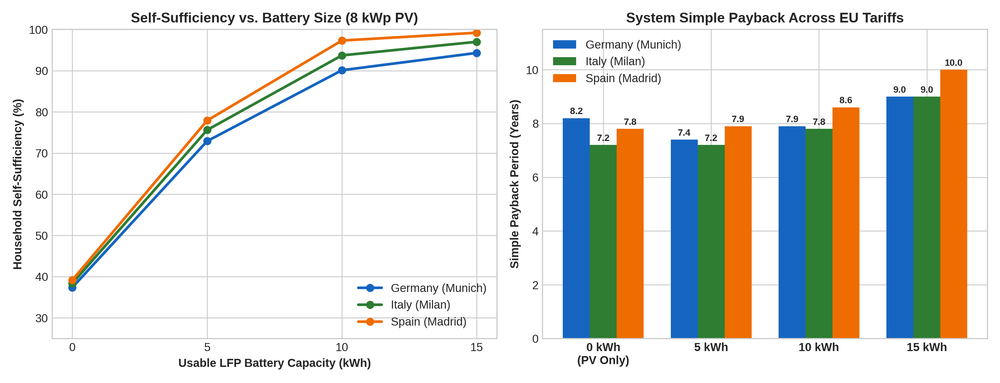

# Residential PV & Battery Storage (BESS) Sizing & Payback Study Across European Tariffs

An 8,760-hour Python energy-balance and techno-economic study evaluating residential rooftop solar PV paired with Lithium Iron Phosphate (LFP) battery storage across three European electricity markets.

## Methodology & System Parameters
* **PV & Storage System:** 8.0 kWp rooftop PV array paired with 0, 5, 10, and 15 kWh usable LFP battery capacities (95% round-trip efficiency, 0.5C charge/discharge limit).
* **Load Profile:** 4,500 kWh/yr residential consumption profile featuring morning and evening peaks and seasonal winter heating/lighting uplift.
* **European Markets Modeled:**
  * **Germany (Munich):** 1,100 kWh/kWp yield | €0.36/kWh retail import | €0.079/kWh feed-in tariff
  * **Italy (Milan):** 1,300 kWh/kWp yield | €0.30/kWh retail import | €0.095/kWh export compensation
  * **Spain (Madrid):** 1,600 kWh/kWp yield | €0.23/kWh retail import | €0.065/kWh surplus compensation

## Key Findings
* **Optimal Battery Sizing (5–10 kWh):** Adding a 5 kWh LFP battery increases household self-sufficiency from **37.4%–39.2% (PV-only)** to **72.9%–77.9%** and reduces simple payback in Germany from **8.2 to 7.4 years**. Scaling to 10 kWh reaches **90.1%–97.3%** self-sufficiency, while expanding further to 15 kWh yields **<4.2% incremental gain**.
* **Tariff Spread Drives Storage Economics:** Wide spreads between retail import tariffs and feed-in compensation in Germany (€0.28/kWh spread) and Italy (€0.21/kWh spread) yield faster payback periods (**7.2–7.9 years** for 5–10 kWh systems) than in Spain (**7.9–8.6 years**) despite lower annual solar irradiation.

## Simulation Results Across EU Markets

| Market | Battery Size (kWh) | Self-Sufficiency (%) | Self-Consumption (%) | Total CapEx (€) | Annual Savings (€/yr) | Simple Payback (yrs) |
| :--- | :---: | :---: | :---: | :---: | :---: | :---: |
| **Germany (Munich)** | 0 | 37.4% | 19.1% | €9,600 | €1,168 | 8.2 |
| **Germany (Munich)** | 5 | 72.9% | 38.2% | €12,000 | €1,611 | 7.4 |
| **Germany (Munich)** | 10 | 90.1% | 47.5% | €14,400 | €1,824 | 7.9 |
| **Germany (Munich)** | 15 | 94.3% | 49.8% | €16,800 | €1,877 | 9.0 |
| **Italy (Milan)** | 0 | 38.4% | 16.6% | €9,600 | €1,342 | 7.2 |
| **Italy (Milan)** | 5 | 75.6% | 33.6% | €12,000 | €1,677 | 7.2 |
| **Italy (Milan)** | 10 | 93.7% | 41.8% | €14,400 | €1,839 | 7.8 |
| **Italy (Milan)** | 15 | 97.0% | 43.4% | €16,800 | €1,868 | 9.0 |
| **Spain (Madrid)** | 0 | 39.2% | 13.8% | €8,800 | €1,123 | 7.8 |
| **Spain (Madrid)** | 5 | 77.9% | 28.1% | €11,050 | €1,404 | 7.9 |
| **Spain (Madrid)** | 10 | 97.3% | 35.3% | €13,300 | €1,545 | 8.6 |
| **Spain (Madrid)** | 15 | 99.2% | 36.1% | €15,550 | €1,559 | 10.0 |

## Data Sources & Assumptions Basis
* **Solar Irradiation & Yield:** Calibrated to regional European climate averages from the European Commission **PVGIS** (Photovoltaic Geographical Information System) database for Munich, Milan, and Madrid.
* **Electricity & Feed-In Tariffs:** Based on **Eurostat** residential household electricity price bands (2,500–5,000 kWh/yr) and national surplus compensation benchmarks (German EEG *Teileinspeisung* ≤10 kWp via **Bundesnetzagentur**, Italian *Ritiro Dedicato*, and Spanish residential surplus tariffs).
* **System CapEx & Storage Specs:** Reflects 2026 European turnkey residential PV pricing (including 0% VAT in Germany) and modular LFP battery pricing at 95% round-trip efficiency.

## How to Run
Open `PV_BESS_European_Tariffs_Study.ipynb` in Google Colab or Jupyter Notebook and run all cells (`Runtime -> Run all`).
